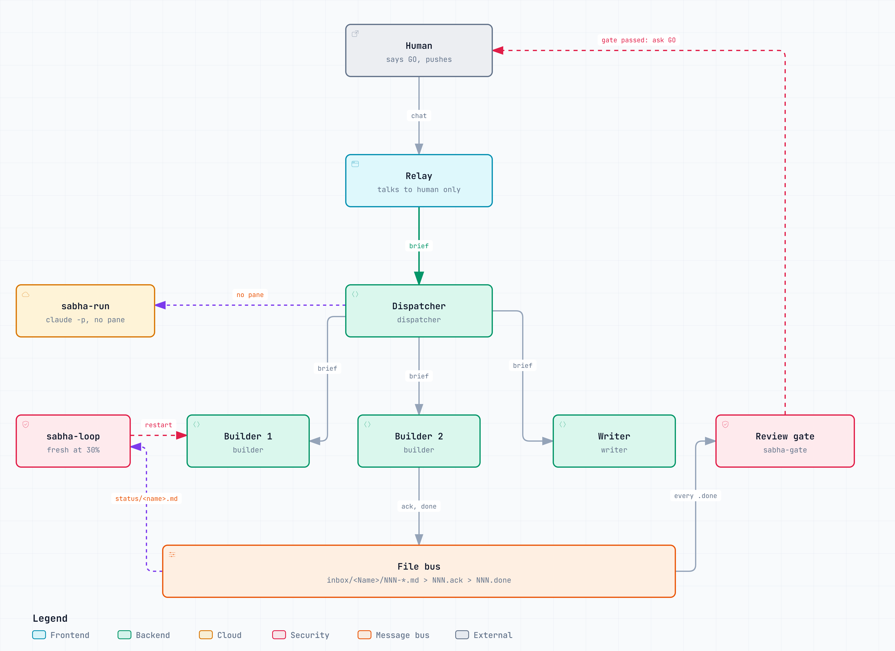
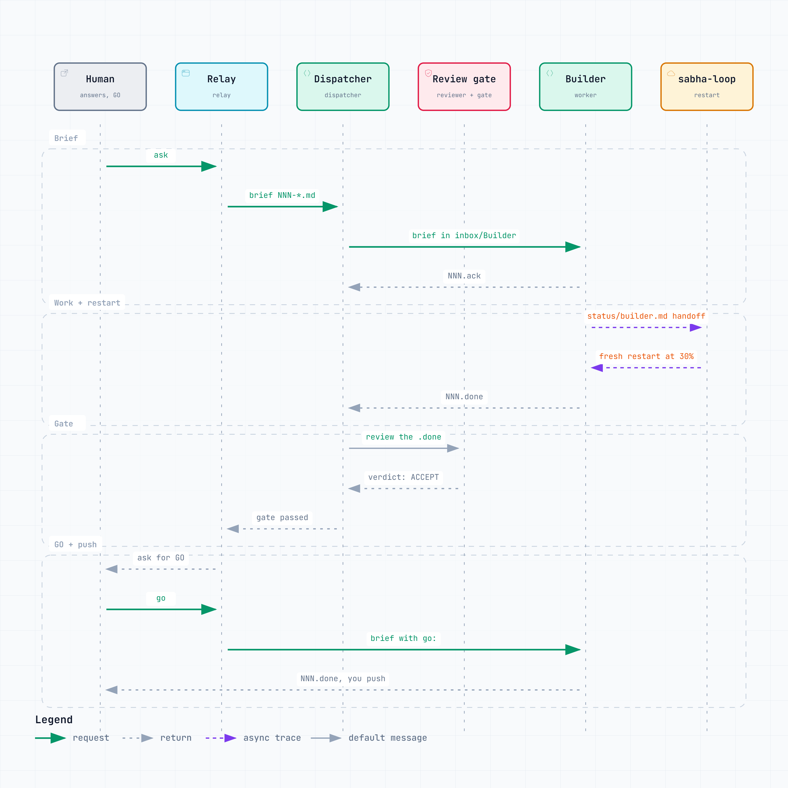

# claude-sabha

Run a team of named coding-agent sessions - a relay you talk to, a dispatcher and workers - that hand each other
work through plain files, keep their progress in plain files, and restart fresh before their context fills up.

Status: 1.0.0, first public release. macOS is used daily; Windows (Git Bash) is beta (see
[docs/windows.md](docs/windows.md)). Anything marked UNTESTED below has not been run on a real machine; the full list is in [docs/known-gaps.md](docs/known-gaps.md).

## Feedback for v2

Ideas go in [GitHub Discussions](https://github.com/The-Harsh-Vardhan/claude-sabha/discussions), bugs in
[Issues](https://github.com/The-Harsh-Vardhan/claude-sabha/issues).

## Try it first

[docs/quickstart.md](docs/quickstart.md) is a 10-minute demo: a brief, a worker, a review, a handoff and a fresh restart.

[RULES.md](RULES.md) holds the seven working rules (paste them into your `CLAUDE.md`). [template/impl/](template/impl)
is a starter project folder: a generic core protocol, six role cards, one status file, a goals file and sample items.

## Pick a plan

The workflow is the same on every plan; only the roster, the number of panes and the models differ. Each plan is a file
beside `sabha.conf` that `bin/sabha-up.sh --plan <name>` (or `SABHA_PLAN=<name>` in `sabha.conf`) loads.

| Plan | File | Panes | Copies per role | Models |
| --- | --- | --- | --- | --- |
| Pro ($20) | `sabha.pro.conf` | 5: Vidur, Yudhishthira, Bhima, Arjun, Nakul | 2 | No top tier; models pinned. Sonnet for the relay, dispatcher and builders; the architect (Opus) and the reviewer (Haiku) are subagents, one brief at a time |
| Max 5x ($100) | `sabha.max5.conf` | 7: the Pro five plus Sahadev and Karna | 4 | Opus for the relay, the dispatcher and the gates; Sonnet for builders and scribe |
| Max 20x ($200) | `sabha.max20.conf` | 10 panes in two tabs (Build, Gate) | 4 | Opus relay and dispatcher, the top tier for the architect; the critics start per brief |

A profile is `Name (Role) = agent:model:effort`; a roster row is `Name:agent:model[:effort[:flags]]`. Every profile
without a pane is an on-demand subagent of the dispatcher with its own model and effort. `SABHA_PANES` picks the panes;
`SABHA_MAX_COPIES` allows `Arjun-1`, `Arjun-2` ... each with its own inbox, status file and worktree.

## Themes

Pick who your team is: `SABHA_THEME` in `sabha.conf`, or `bin/sabha init --theme <name>`. A theme renames the roles,
gives each a colour (statusline and board) and a one-line persona (in its opening prompt); scripts, roles and models
stay the same.

| Theme | Relay | Dispatcher | Architect | Builders |
| --- | --- | --- | --- | --- |
| `mahabharat` (default) | Vidur | Yudhishthira | Bhishma | Bhima, Arjun |
| `avengers` | Jarvis | Fury | Stark | Hulk, Hawkeye |
| `hogwarts` | Hedwig | McGonagall | Dumbledore | Hagrid, Harry |
| `middle-earth` | Gwaihir | Aragorn | Elrond | Gimli, Legolas |
| `plain` | Relay | Dispatcher | Architect | BuilderHeavy, BuilderPrecise |

All 20 roles per theme, the file format and how to add your own: [themes/README.md](themes/README.md). The Avengers,
Hogwarts and Middle-earth themes are fan themes; the names belong to their owners and claude-sabha is not affiliated
with or endorsed by them.

## Agents

| Agent | Role in sabha | Status |
| --- | --- | --- |
| `claude` (Claude Code) | Pane and headless runs; context percent, restart loop, usage alerts | Tested (macOS): headless run, statusline, restart loop; pane start through herdr UNTESTED |
| `opencode` | Pane started through herdr | UNTESTED live (`agent start` is not yet run on a real herdr) |
| `codex` | Pane started through herdr | UNTESTED |
| `agy` (Antigravity CLI) | Pane started through herdr | UNTESTED |
| `muse` (Muse Spark, via the opencode Meta provider) | Pane started through herdr | UNTESTED |

Non-Claude panes stay headful and restart after each brief (when `NNN.done` appears), not at a context percent: only
Claude exposes its context to the statusline hook. `sabha-run` serves Claude roles only.

herdr is the default terminal backend on every OS (`brew install herdr`; Apache-2.0). Sabha runs in its own named
herdr session, `SABHA_HERDR_SESSION` (default `sabha`), and never uses herdr's default session, which holds your own
workspaces: every herdr call carries `--session`, `sabha-up.sh` starts that session's server (a named session has none
until started) and waits for `status: running`, and `sabha-down.sh --yes` stops and deletes that session only.
Observed on a real herdr 0.9.4 in a throwaway session: the server start and `status: running` line, the `workspace
create`, `workspace list`, `pane list` and `agent list` JSON, `workspace close`, and `session stop` / `session delete`.
Still UNTESTED on a real herdr: `agent start`, `agent prompt`, `agent wait`, `agent read`, `send-keys` and `pane split`
(see [docs/known-gaps.md](docs/known-gaps.md)). `SABHA_BACKEND=iterm` keeps the frozen macOS iTerm2 path as a fallback.
The files stay the source of truth; herdr only wakes a pane (`bin/sabha-nudge <Name> "text"`).

## Remote control and progress

Three needs, by how far sabha goes. **See progress** and **get pinged** work for every agent from sabha's own files
(the board, `sabha-watch`, the tracker, a phone push). **Send instructions** from a phone depends on the agent:

| Path | Covers | Sends and views | Notes |
| --- | --- | --- | --- |
| Claude Remote Control (`SABHA_REMOTE=1` passes `--remote-control` to Claude panes) | Claude | Both | Pro and Max accounts only; not Team or Enterprise, and an organisation policy can block it (`sabha doctor` warns). The laptop must stay awake and online. Running it inside a herdr pane is UNTESTED |
| OpenCode `serve` / `web`, with `OPENCODE_SERVER_PASSWORD`, behind Tailscale | OpenCode, Muse | Both | Never expose the port to the internet; basic auth over plain HTTP leaks the password off a private network. How `attach` passes the password: unverified |
| Codex via the ChatGPT phone app | Codex | Claimed both | UNTESTED; whether it covers the plain `codex` CLI is unverified |
| `agy --remote-control` | Antigravity | Unverified | UNTESTED; the source is a third-party article, not a vendor page |
| SSH over Tailscale, then `herdr attach` | Every agent | Both | The generic path; clumsy to type on a phone. Needs an SSH server on the laptop (Mac: Remote Login) and a phone SSH app. `herdr attach` is not available on Windows. In a desktop editor, run `herdr attach` in its integrated terminal to see and chat with any pane |
| Phone push (`SABHA_PUSH=ntfy`) | Every agent | View only | One `curl` line per alert, see below |

Phone push privacy: ntfy topics on the public server are readable by anyone who knows the topic name, and the server
logs the topic and your IP. `sabha init --push ntfy` generates a random topic and keeps it in `sabha.conf` (gitignored);
treat the name like a password, and self-host ntfy if the alerts name anything sensitive. Telegram and Pushover are not
built.

Untested and limited parts of this release, and how to confirm each: [docs/known-gaps.md](docs/known-gaps.md).

## Limits and alerts

`bin/statusline-sabha.sh` (install it as your Claude `statusLine` command; `sabha doctor` checks) writes each session's
context percent to `status/context/<name>.txt` and the account's usage windows to `status/limits.txt`.
`SABHA_NOTIFY="10 20 30 40 50 60 70 80 90"` fires once per step on either window (the 5-hour and the 7-day): a
desktop notification, the `sabha-watch` banner and a line in `status/alerts.log`. `SABHA_STOP=90` stops new sessions
at that percent of either window until it resets; running briefs finish and nothing is killed. The Windows toast is
UNTESTED. A per-role cost log is written to `status/cost-log.tsv`.

## Restart loop

`bin/sabha-loop <Name>` supervises one pane. A Claude pane restarts when its context file reads `SABHA_LOOP_LIMIT` (30)
percent or more and its handoff is newer than the last start: fresh session, same opening prompt, never `--resume`. A
context file older than two minutes is not trusted (the agent keeps running and a warning shows). Two failed restarts
in a row stop the loop.

## Tracker

One task list for everything you ask the team to do, in three forms, chosen with `SABHA_TRACKER`:

| Value | What | Needs |
| --- | --- | --- |
| `html` (default) | One offline page built from the CSVs by `tracker/build-html.py` | Nothing, no login |
| `xlsx` | `tracker/build-xlsx.py` writes an 8-tab workbook (header rows, dropdowns, a Dashboard of counts) to import into any spreadsheet | `openpyxl` in a repo-local `.venv` (`uv venv .venv && uv pip install --python .venv/bin/python openpyxl`); the layout is approximate, tune it |
| `sheet` | A Google Sheet that `bin/sabha sheet-sync` fills from the CSVs (`bin/sabha sheet-auth` once) | Your own Google OAuth client; the live calls are UNTESTED, only `--dry-run` is tested |

Sheet setup, once: enable the Google Sheets API in a Cloud project, create a Desktop-app OAuth client and save its JSON
as `~/.config/sabha/client.json`, run `bin/sabha sheet-auth` (a browser opens once), then set `SABHA_SHEET_ID` in
`sabha.conf` and run `bin/sabha sheet-sync`. The token stays in `~/.config/sabha/`, never in the repo. The sync writes
data rows only; the Inbox tab column names and the Agents M-N headers are guesses (UNTESTED against a live sheet).

The Google Sheet is the better option: it works on a phone, you can share it, and it carries the Inbox and Decisions
round trip (you write in the sheet, the agents pick it up). The HTML page is the default only because it needs no login.
`SABHA_SHEET_AGENT_SYNC` lets an agent session with a Sheets connector sync every 30 minutes instead; it is off by
default on every plan because it is 48 agent runs a day that use subscription usage even when nothing changed (tokens
per run not measured); `bin/sabha sheet-sync` does the same for free. The CSV headers are in
`tracker/templates/`; `bin/sabha-tracker` edits a row atomically; `tracker/repos-export.py` writes a per-checkout git
state CSV (parameterised by environment variables).

## Configuration

The settings you will touch are in `sabha.conf.example`. These optional environment knobs also exist (defaults read
from the scripts):

| Variable | Default | Used by |
| --- | --- | --- |
| `SABHA_HERDR_SESSION` | `sabha` | every herdr call: the session sabha runs in (never herdr's default session) |
| `SABHA_DOWN_TIMEOUT` | `300` (seconds) | `sabha-down.sh`: wait for the save briefs (`--timeout S` overrides) |
| `SABHA_KILL` | `kill` | `sabha-down.sh`: the command that signals processes (a test hook; leave it alone) |
| `SABHA_KILL_GRACE` | `3` (seconds) | `sabha-down.sh`: wait between TERM and KILL |
| `SABHA_NUDGE_TIMEOUT` | `120000` (milliseconds) | `sabha-nudge`: how long `herdr agent prompt --wait` waits |
| `SABHA_RFC_SECTIONS` | `Summary,Problem,Goals,Non-goals,Design,Alternatives,Risks,Open questions` | `sabha-rfc-check`: the required `##` sections |
| `SABHA_NOTIFY_DESKTOP` | `1` | usage alerts: `0` keeps them to `status/alerts.log` (tests, headless hosts) |
| `SABHA_SETTINGS` | `~/.claude/settings.json` | `sabha doctor`: the Claude settings file checked for the statusline hook |

## Commands

| Command | What |
| --- | --- |
| `bin/sabha init [--plan pro\|max5\|max20] [--tracker html\|xlsx\|sheet] [--push ntfy\|off]` | Writes `sabha.conf` (gitignored): plan, OS, the agent CLIs found, tracker, ntfy topic. Asks for what it is not given on a terminal |
| `bin/sabha doctor` | Checks the CLIs, the statusline hook, `jq`, herdr, write permissions and the Remote Control policy; exits 1 only on a FAIL |
| `bin/sabha-up.sh [--plan <plan>] [<Name>]` | Opens the herdr workspace, or starts one role; `--print <Name>` prints the restart line first, then a `pane:` line |
| `bin/sabha-check` | Read-only list of each role's processes; DUPLICATE when more than one holds a name |
| `bin/sabha-down.sh [--yes]` | Asks each pane role to save, waits, stops what still holds a role name, closes the window; a dry run without `--yes` |
| `bin/sabha-nudge <Name> "text"` | Wakes one pane (`herdr agent prompt --wait`) |
| `bin/sabha-loop <Name>` | The restart supervisor for one pane |
| `bin/sabha-watch` | Read-only report: context percent, restart lines, open items, unacked briefs, usage banner |
| `bin/sabha-for-me` | Renders `FOR-ME.md` and `FOR-ME.html` (the board) from `for-me.items`, status files and `GOALS.md`; `--csv` writes the tracker CSVs |
| `bin/sabha-run` | Headless runner: one `claude -p` per brief for roles with no pane ([docs/headless-runner.md](docs/headless-runner.md)) |
| `bin/sabha sheet-auth`, `bin/sabha sheet-sync` | Google Sheet tracker (above) |
| `bin/sabha update` | Fast-forward pull of the install directory, then the head of `CHANGELOG.md`; runs nothing it pulled |
| `bin/sabha-brief`, `bin/sabha-gate`, `bin/sabha-rfc-check`, `bin/sabha-tracker`, `bin/sabha-worktree` | The brief numbering, the review gate, an RFC lint, atomic CSV edits and `<repo>--<slug>` worktrees; briefs say "run the script" |
| `tests/*.sh` | The test suite; `tests/test-leak.sh` fails when a tracked file holds a name, a home path, an id or a token |

## Setup

1. Requirements: Claude Code (`claude` on PATH, logged in), bash (3.2 or later), python3, `jq`, herdr. On Windows use
   Git Bash (beta).
2. Run `bin/sabha init`, then `bin/sabha doctor`. `sabha.conf` is gitignored; `SABHA_CONF` points the scripts at another file.
3. Copy `template/impl` to wherever `SABHA_IMPL` points and create `inbox/<Name>/` for each role, `status/context/`,
   `status/.bak/` and `questions/`. Add `SABHA_PROTOCOL_CORE=PROTOCOL-core.md` and `SABHA_ROLE_DIR=protocol` to `sabha.conf`.
4. From a plain terminal (not from inside a Claude session; its sandbox blocks terminal automation):
   `bin/sabha-up.sh --plan pro`.
5. Install the deny list if you want it: merge `share/claude-settings.json` into your Claude settings (no remote
   pushes, `gh pr`, recursive deletes, `.env` or `.npmrc` reads).

The roster names are the default theme (Mahabharat); rename them in the roster in `sabha.conf` or a plan file, the one
roster source for the launchers, `sabha-watch` and the board.

## What is in it

| Path | What |
| --- | --- |
| `bin/` | The scripts above, including `sabha-check` and `sabha-down.sh` |
| `sabha.conf.example`, `sabha.<plan>.conf` | The config every script reads and the three plan rosters |
| `template/impl/` | A starter `SABHA_IMPL`: `PROTOCOL-core.md`, `protocol/<Name>.md` cards, `status/vidur.md`, `GOALS.md`, `for-me.items` |
| `tracker/` | CSV templates, the HTML and xlsx builders, `cron-prompts.md`, `repos-export.py` |
| `docs/inbox-protocol.md` | The file formats: briefs, acks, dones, cancels, the GO token, `for-me.items`, status files |
| `docs/quickstart.md`, `docs/windows.md`, `docs/headless-runner.md` | The demo, the Windows notes and the runner design |
| `share/claude-settings.json` | The safe-defaults deny list |
| `RULES.md` | Seven working rules for your own `CLAUDE.md` |
| `icons/<theme>/` | One icon per role for each theme (optional) |

## Headless roles

A role flagged `lazy` has no pane. `bin/sabha-run` starts it when a brief lands: it acks the brief, runs
`claude -p` with the role's model, effort and opening context, and the process exits once `NNN.done` and the status
file are written, so the role holds memory only while it works. Run `bin/sabha-run` after writing a brief, or set
`SABHA_RUN_AUTO=1` and let each `bin/sabha-watch` run start what is due. At most `SABHA_RUN_MAX` (2) run at once, one
per role; each is stopped after `SABHA_RUN_TIMEOUT` seconds and logged under `SABHA_IMPL/runs`. A permission prompt
is denied, never skipped: the run writes the denial to `for-me.items` and a BLOCKED done. macOS and Linux only for
now. Design: [docs/headless-runner.md](docs/headless-runner.md).

## Install as a Claude Code plugin

The plugin wraps the scripts above as slash commands, skills and hooks. It is UNTESTED live: nothing below has run
inside a real Claude Code session yet. Run these inside Claude Code:

    /plugin marketplace add The-Harsh-Vardhan/claude-sabha
    /plugin install claude-sabha@claude-sabha

Alternatively, from a local clone: `/plugin marketplace add /path/to/claude-sabha`, then the same install line.
The scripts in `bin/` still need `sabha.conf` (`bin/sabha init`); the plugin does not
replace the setup steps above.

## Commands, skills and hooks

All rows are UNTESTED live.

| Command | What |
| --- | --- |
| `/sabha-start` | Opens the workspace (`sabha-up.sh`) |
| `/sabha-stop` | Saves and closes the panes (`sabha-down.sh`; a dry run until confirmed) |
| `/sabha-status` | The read-only report (`sabha-watch`, `sabha-check`) |
| `/sabha-board` | Renders and shows the board (`sabha-for-me`) |
| `/sabha-run` | One headless-runner pass (`sabha-run`) |
| `/sabha-brief` | Claims a number and writes a brief (`sabha-brief`) |
| `/sabha-handoff` | Writes the role's handoff block to its status file |
| `/sabha-restart` | Prints or runs the fresh-restart line for a role |
| `/sabha-init` | Writes `sabha.conf` (`sabha init`) |
| `/sabha-doctor` | Checks the machine (`sabha doctor`) |
| `/sabha-gate` | Evaluates the review gate (`sabha-gate`) |

| Skill | What |
| --- | --- |
| `sabha-brief-writing` | How to write a brief: goal, inputs, constraints, done-when, the `go:` and `gate:` lines |
| `sabha-handoff-writing` | The handoff shape (`Task`, `Done`, `Next`, `Constraints`) and when to write it |
| `sabha-gate-review` | How a reviewer or critic writes a verdict file the gate can read |
| `sabha-relay` | The relay's job: talk to the user, brief the dispatcher, do no work |
| `sabha-dispatch` | The dispatcher's job: route by difficulty, track acks and dones, run work in parallel |

| Hook | What |
| --- | --- |
| SessionStart | Loads the role's handoff and its open briefs |
| PreToolUse guard | Blocks `git push`, `gh pr` and chat-service writes for every role except the relay |
| Stop | Reminds the role to update its handoff before the session ends |

How these plug into the file bus: [ARCHITECTURE.md](ARCHITECTURE.md).

## Files and owners

A project folder has one owner role per file: `ARCHITECTURE.md` (architect), `DECISIONS.md` (scribe), `LESSONS.md`
(coach), `TODOS.md` (relay, generated from the tracker), `status/<name>.md` (every role, its own) and `GOALS.md`.
Starters are in `template/impl/`; [template/CLAUDE.md](template/CLAUDE.md) is the workspace `CLAUDE.md` with the full
table of who updates what and when.

## Works with

Sabha does not depend on these and has no integration code for them; each can be used alongside it.

- gstack: its review and ship skills can be run by a worker inside its worktree; sabha's own gate and GO token still
  decide whether a fold, push or PR may happen.
- pstack: its per-role model and effort choices can be mapped onto the roster, one role to one profile
  (`Name:agent:model:effort`), so the two agree on which role gets the strong model.
- superpowers: its planning, TDD and debugging skills can be used inside any worker session; they shape how a worker
  does a brief, while sabha shapes how briefs move between sessions.

## License

MIT, see [LICENSE](LICENSE).
