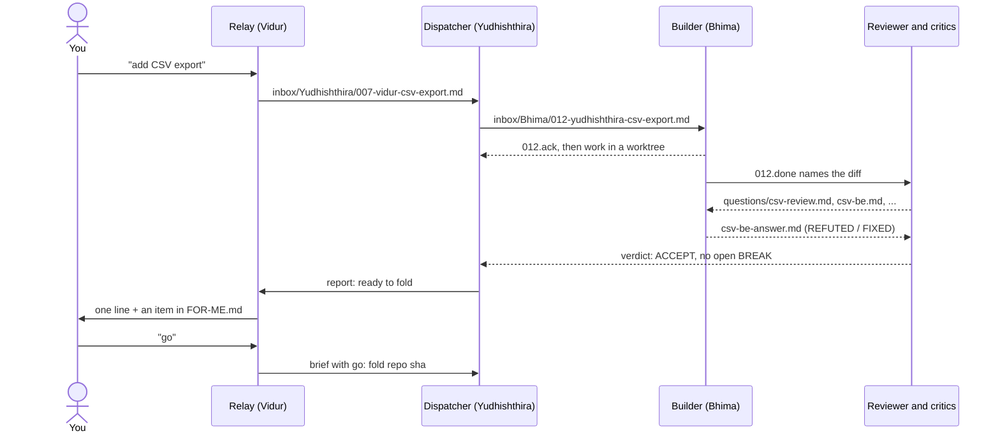
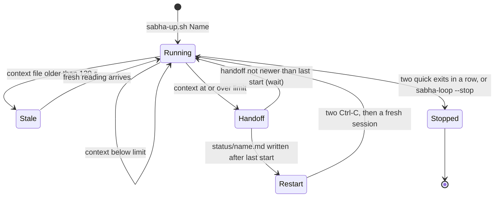
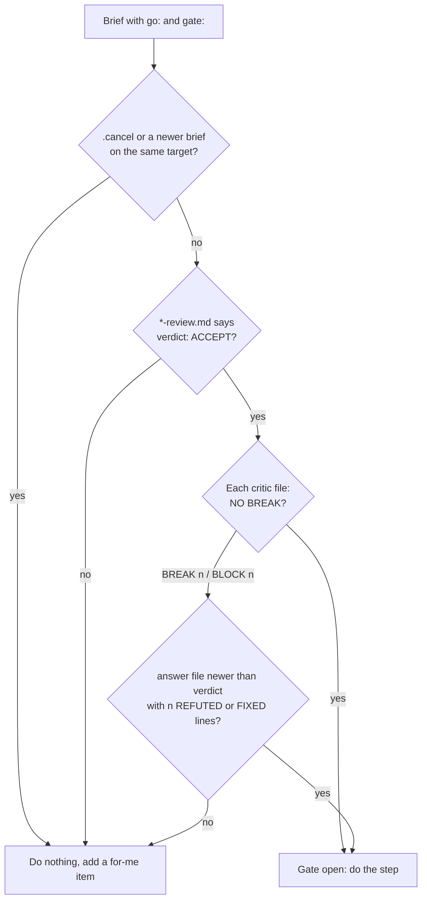
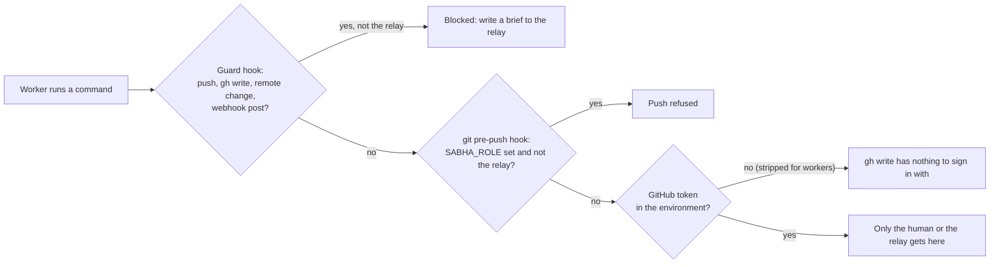
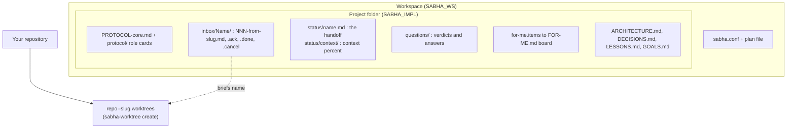

# How it works, in five pictures

Every arrow below is a file on disk or a script in `bin/`. Nothing is hidden in a model's memory: if a session
dies, the next one reads the same files and carries on. Role names are the default ids; a [theme](themes.md) renames
them on screen.

## 1. One brief, end to end

You talk to the relay only. Work moves as numbered files in each role's inbox: a brief, then an `.ack` when a worker
claims it, then a `.done` with the result. A `.cancel` stops it.

## 2. Fresh context instead of a full one

`bin/sabha-loop` runs in each pane. When a role's context reaches the limit (30 percent by default) and it has
written a fresh handoff to `status/<name>.md`, the loop quits the session and starts a new one with the same opening
prompt. The new session reads the handoff and the open briefs, never `--resume`.

## 3. The gate before anything irreversible

A fold, push, PR, tag, release or migration needs a `go:` line in the newest brief, and every verdict file the brief's
`gate:` line names must pass. `bin/sabha-gate` turns that rule into an exit code.

## 4. Who may reach outside the machine

Three layers, each catching what the one above misses. Details and known gaps: [SECURITY.md](https://github.com/The-Harsh-Vardhan/claude-sabha/blob/main/SECURITY.md).

## 5. Where everything lives

Next: the [Roster](roster.md) shows all 20 roles side by side in every theme.
