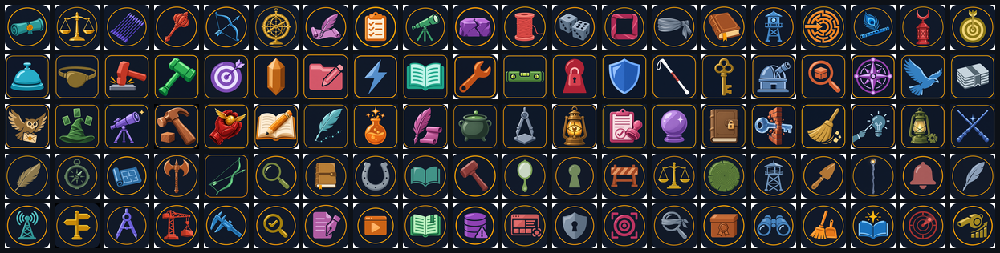

# claude-sabha

Run a team of named coding-agent sessions - a relay you talk to, a dispatcher and workers - that hand each other
work through plain files, keep their progress in plain files, and restart fresh before their context fills up.

Twenty roles, one job each, in the theme you pick: see the [Roster](roster.md). New here? [How it works](how-it-works.md)
explains the whole system in five pictures.

Interactive version: [architecture](diagrams/architecture.html). Design notes: [Architecture](architecture.md).

Status: 1.0.0, first public release. macOS is used daily; Windows (Git Bash) is beta (see [Windows](windows.md)).
Anything UNTESTED has not been run on a real machine; the full list is in [Known gaps](known-gaps.md).

## Install as a Claude Code plugin

Run these inside Claude Code:

    /plugin marketplace add The-Harsh-Vardhan/claude-sabha
    /plugin install claude-sabha@claude-sabha

The scripts in `bin/` still need `sabha.conf` (`bin/sabha init`); the plugin does not replace the setup steps. Then
follow the [Quickstart](quickstart.md), a 10-minute demo of a brief, a worker, a review, a handoff and a fresh restart.

## Pick a plan

The workflow is the same on every plan; only the roster, the number of panes and the models differ. Each plan is a file
beside `sabha.conf` that `bin/sabha-up.sh --plan <name>` loads.

| Plan | File | Panes | Copies per role | Models |
| --- | --- | --- | --- | --- |
| Pro ($20) | `sabha.pro.conf` | 5: Vidur, Yudhishthira, Bhima, Arjun, Nakul | 2 | No top tier; models pinned. Sonnet for the relay, dispatcher and builders; the architect (Opus) and the reviewer (Haiku) are subagents, one brief at a time |
| Max 5x ($100) | `sabha.max5.conf` | 7: the Pro five plus Sahadev and Karna | 4 | Opus for the relay, the dispatcher and the gates; Sonnet for builders and scribe |
| Max 20x ($200) | `sabha.max20.conf` | 10 panes in two tabs (Build, Gate) | 4 | Opus relay and dispatcher, the top tier for the architect; the critics start per brief |

## Feedback for v2

Ideas go in [GitHub Discussions](https://github.com/The-Harsh-Vardhan/claude-sabha/discussions), bugs in
[Issues](https://github.com/The-Harsh-Vardhan/claude-sabha/issues). Source and full README:
[GitHub](https://github.com/The-Harsh-Vardhan/claude-sabha). License: MIT.
